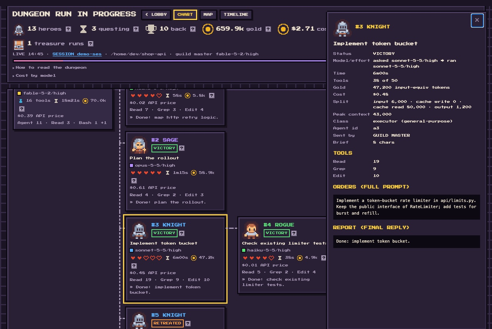
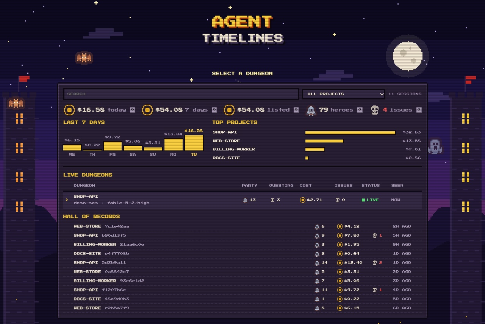
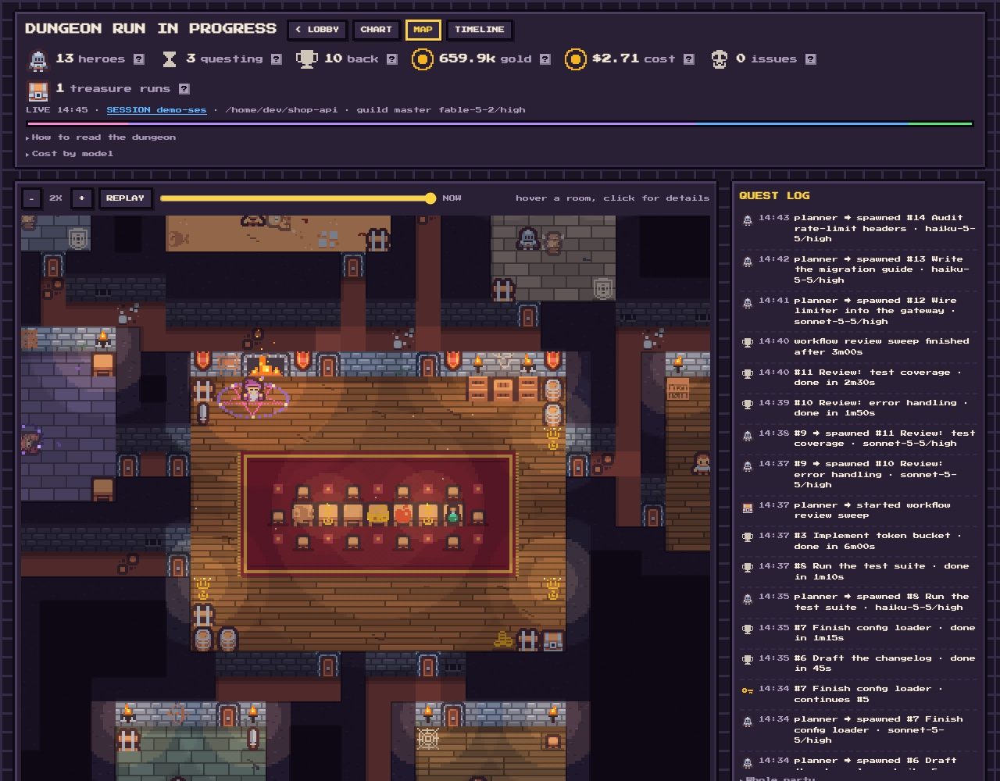

# agent-timelines

[](https://github.com/jasondasuki/agent-timelines/actions/workflows/ci.yml) [](https://github.com/jasondasuki/agent-timelines/blob/main/LICENSE)

A pixel-art dashboard for Claude Code sessions. It shows which agent spawned which, the model and effort
requested vs. what actually ran, tool calls, weighted token cost and dollars, handoffs and Workflow runs, live while the
session works. Everything is read from your local transcripts; nothing leaves your machine.



- **Lobby**: your 200 most recent sessions as a retro game-server list under a pixel night sky (a day sky in the light colour scheme).
  Live dungeons get a full row; the hall of records is one short line per past session. There is search, a project filter and
  paging (`/` focuses the search box, left/right change the page). A ledger on top sums what the listed sessions cost:
  today, the last 7 days by day, and the costliest projects (click one to filter).
- **Chart view**: the delegation tree as a party of heroes, with flags for rule breaks (no model set,
  model mismatch, ignored tool limit, unanswered handoff, …).
  Each card shows the agent's top tools and the start of its final reply; the detail panel lists every tool and the full report
  (a running agent shows what it is saying now).
- **Timeline view**: one bar per agent on a shared clock, rows in party-tree order, so you can see who ran when and what overlapped.
  Running agents get a striped bar; zoom with + and -.
- **Map view**: the same session as a procedurally generated, torch-lit dungeon. The main session is the guild master
  in the guild hall, casting over a pentagram while agents work; each agent has its own room and fights an enemy while it works, then celebrates.
  - A room's look follows the agent's class: armory, library, lab, study, sand pit, vault for a workflow, crypt for the rest.
  - Torches burn brighter while the agent works and turn green if the agent failed or ignored its tool limit.
  - A new hero walks the corridors to its room, carrying a key if it continues a handoff.
  - Hover a room for its agent, click it for details.
  - REPLAY plays the whole session back on the map; drag the slider to see any moment.




(The screenshots show a synthetic demo session.)

## Install

Needs Python 3.9+ on macOS or Linux (Windows is not supported). No other dependencies. Use one of the two options, not both.

**Option A: the command-line tool from PyPI** (needs [uv](https://docs.astral.sh/uv/) or pipx)

```sh
uv tool install agent-timelines   # or: pipx install agent-timelines
agent-timelines install    # adds 6 hooks to ~/.claude/settings.json (writes a backup next to it first)
agent-timelines rebuild    # optional: fills the lobby with your sessions from the last 30 days
agent-timelines serve      # opens http://127.0.0.1:8765/index.html (localhost only)
```

**Option B: the Claude Code plugin** (no pip, no settings.json edit; the hooks come with the plugin)

```sh
claude plugin marketplace add jasondasuki/agent-timelines
claude plugin install agent-timelines@agent-timelines
```

Then ask for the dashboard with `/agent-timelines:dashboard`. The plugin's hooks run `python3` from your PATH, so Python 3.9+ must be there.
If `agent-timelines install` hooks are also in settings.json, the plugin's hooks stay quiet so nothing is built twice.

Start or continue a Claude Code session; it appears in the lobby on its first hook event.

| Command | What it does |
|---|---|
| `install [--settings PATH]` | Add the hooks (replaces earlier agent-timelines hooks, keeps all others). |
| `uninstall [--settings PATH]` | Remove the hooks. Your data folder stays. |
| `serve [--port N] [--no-browser]` | Serve the dashboard on 127.0.0.1. |
| `open [SESSION-PREFIX]` | Build one session (newest by default) and open it from disk, no server. |
| `rebuild [--days N]` | Regenerate data for recent sessions from their transcripts. |
| `list` | Recent sessions with their subagent counts. |

`--settings` targets another Claude config dir, e.g. `--settings ~/.claude-work/settings.json`.
`CLAUDE_CONFIG_DIR` is respected for the default paths.

Data lives in `~/.claude/agent-timelines/` (one `<session>.data.js` and one `<session>.prompts.js` per session, removed after 30 days untouched).
The pages hold prompt text from your sessions, which is why `serve` binds to localhost only and refuses requests that come from other sites (wrong `Host`, or a cross-site script or fetch).

## Config (optional)

`~/.config/agent-timelines/config.json` (or `$AGENT_TIMELINES_CONFIG`). Every key is optional:

```json
{
  "out_dir": "~/.claude/agent-timelines",
  "ctx_limit": 200000,
  "tool_limit": 50,
  "brief_limit": 8000,
  "retain_days": 30,
  "lobby_limit": 200,
  "handover_dir": "~/.claude/handovers",
  "agents_dir": "~/.claude/agents",
  "guard_text": "Main session does not execute",
  "tiers": {"Explore": "scanner", "Plan": "plan", "general-purpose": "executor"},
  "rules": {"no-model": true, "no-effort": true},
  "prices": {"gpt-6": {"in": 1, "out": 2}}
}
```

`tool_limit` is unset by default, so there are no hearts, only a tool count; set it to the number your hand-off hook uses.
`brief_limit`, `guard_text` and `handover_dir` match optional hand-off and guard hooks of your own;
without such hooks those flags never fire. `tiers` maps agent types to character classes.
`rules` turns single flags on or off by name; a flag you do not list keeps its default. `no-model` and `no-effort` are off by default;
turn them on if your setup requires every spawn to name a model and effort. The flag names are `no-model`, `no-effort`, `auto-filled`,
`frontmatter`, `model-mismatch`, `effort-mismatch`, `ctx` (the context-size flag), `handoff`, `tool-limit`, `ignored-limit`, `orphan`
and `handoff-not-continued`; an unknown name is an error.

`prices` adds or changes entries of the built-in price table (USD per million tokens; the table is dated, see `PRICES_ASOF` in `timeline.py`).
The key is a model id prefix without `claude-`, the longest matching key wins, and the columns are `in`, `cc5` (5-minute cache write),
`cc1` (1-hour cache write), `cr` (cache read), `out` and an optional `over` (`[prompt tokens, multiplier]`); a missing column counts as 0.
Entries are merged per model, so you only list what you add or change. A model with no price is shown as unpriced (`$0.00+` on its card),
never guessed.

### Cost

Cost is computed per message from the full model id and the usage recorded in the transcript, at Anthropic first-party API list prices
([pricing page](https://platform.claude.com/docs/en/about-claude/pricing), table dated 2026-11-10). It is what those tokens would cost through the
API; a subscription plan is not billed per token. Not modelled: the 1.1x US-only `inference_geo` surcharge (the transcript does not say whether it
applied), batch discounts, Bedrock and Vertex prices, web-search and other server-tool fees. Gold is the same tokens weighted by cost, as before.

## Development

```sh
python3 tests/test_timeline.py && python3 tests/test_cli.py   # Python
node tests/test_dungeon.js && node tests/test_actors.js && node tests/test_lobby.js && node tests/test_gantt.js   # viewer scripts (Node 18+)
open dev/dungeon-demo.html                                     # dungeon playground: agents, working, reset
```

## Credits

- Sprites: [Kenney](https://www.kenney.nl) "Tiny Dungeon" and "1-Bit Pack", CC0.
- Font: Press Start 2P by CodeMan38, SIL Open Font License 1.1.

Details in `src/agent_timelines/assets/LICENSES.txt`.

## License

MIT, see [LICENSE](https://github.com/jasondasuki/agent-timelines/blob/main/LICENSE). Contributions welcome: see [CONTRIBUTING.md](https://github.com/jasondasuki/agent-timelines/blob/main/CONTRIBUTING.md). Security reports: [SECURITY.md](https://github.com/jasondasuki/agent-timelines/blob/main/SECURITY.md).
